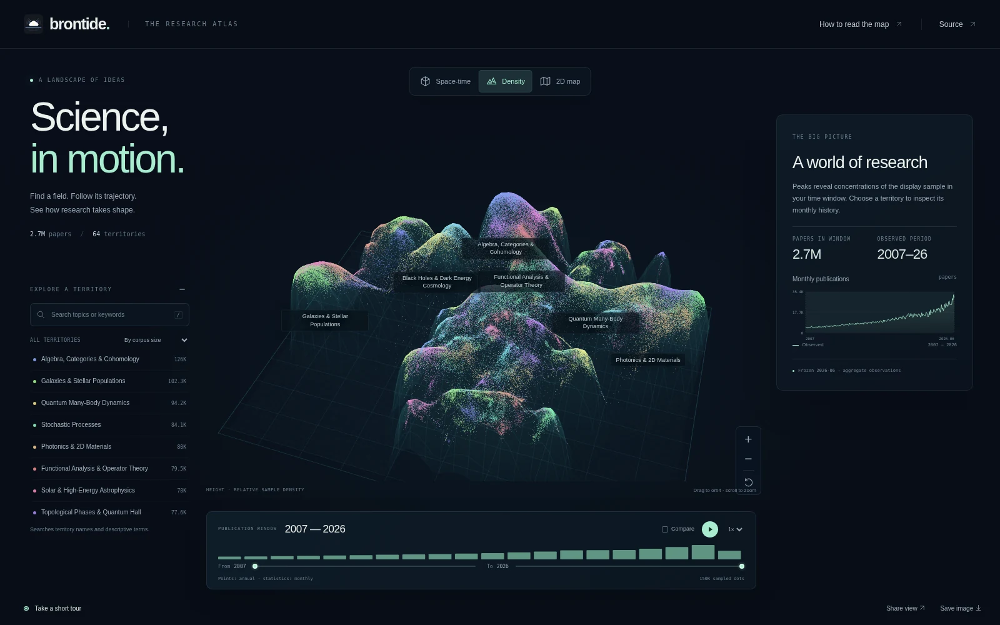

<!-- GENERATED by scripts/make_pypi_readme.py from README.md. DO NOT EDIT. -->
# brontide

**Explore the shape and rhythm of research.**

A visual atlas of 2.7 million arXiv papers. Travel through a semantic landscape,
follow fields through time, and explore the smaller research areas inside them.

**[Open the atlas](https://numberingeometry.github.io/brontide/)** ·
[How to explore](https://github.com/numberingeometry/brontide/blob/main/docs/EXPLORER.md) · [Methods and results](https://github.com/numberingeometry/brontide/blob/main/docs/FORECASTING.md)



[Watch the 90-second showcase](https://numberingeometry.github.io/brontide/assets/atlas-showcase.mp4)
— recorded from the interactive atlas.

## Explore

- **A landscape of research.** Move between an overhead atlas and a three-dimensional
  view of publication time. Pan, zoom, select a region and follow its neighbors.
- **Time in context.** Explore publication years alongside monthly activity curves.
  Compare fields by their share of publications, with observations and forecasts separated.
- **From fields to subareas.** Search named regions and terms, inspect their microregions,
  and follow representative titles into the literature.
- **A view worth sharing.** Take a guided tour, save the selected view in a URL and export an image.

The atlas uses real coordinates and published aggregates. Its display sample contains
149,994 points; the underlying experiment indexes 2,705,992 papers in 1,024 microregions
and 64 broad regions. The explorer snapshot covers January 2007 through June 2026.

## Run locally

The checked-in explorer runs as a static website. From the repository root:

```sh
python -m http.server 8000
```

Open `http://localhost:8000`. No corpus download, GPU or service account is required
for the published snapshot. Use an HTTP server because the application loads its data
bundle as separate files.

Regenerate the explorer data from committed artifacts:

```sh
python -m pip install -e .
python scripts/build_explorer.py
```

## What the views mean

The map projects SPECTER2 representations through PCA and UMAP. Its horizontal axes
are visualization coordinates; apparent distance and empty space have the limits of
that projection. Time views add publication year as height.

Map points have **annual** dates. Activity curves have **monthly** dates. Counts and
shares use committed aggregate tables rather than counts of displayed points.
The density surface shows relative concentration of the stratified display sample;
it is not an estimate of full-corpus publication intensity.
The aggregate monthly series contains 2,691,288 records, fewer than the indexed corpus
total; this distinction is retained in the explorer provenance. The repository does not
contain enough raw metadata to resolve that difference or assign monthly dates to each dot.

Region names summarize keywords and representative titles. They are display labels,
not a supervised taxonomy. Microregion statistics are available separately from the
sampled point map. Representative-title links open a literature search where an exact
paper identifier is unavailable.

The retrospective map uses a fixed geometry. Browsing an earlier year does not reproduce
what a model trained only on that year's literature would have known.

## Forecasting experiment

The atlas includes the archived 24-month forecasting experiment. Its pre-registered
criterion was **not met at any of three evaluation cutoffs (0/3)**. A fixed AutoETS model
achieved mean precision@50 of 0.613, while the cross-validated selector achieved 0.413.
[Methods and results](https://github.com/numberingeometry/brontide/blob/main/docs/FORECASTING.md) explains the comparison and its scope.

The experiment's nominal uncertainty intervals did not meet their calibration criterion.
Forecasts are dated model outputs, not assurances about future research growth.
Region forecast shares are modeled independently and are not jointly normalized.
See [LIMITATIONS.md](https://github.com/numberingeometry/brontide/blob/main/LIMITATIONS.md) for the complete interpretation.

Reproduce the published results using committed artifacts:

```sh
python scripts/verify_results.py
python scripts/verify_selectionconsistency.py
python scripts/verify_coverage.py
```

The frozen validation data and preregistration remain intact. Explorer improvements
retain the scored experiment.

## Pipeline and provenance

| Stage | Method | Output |
|---|---|---|
| Representation | SPECTER2 proximity adapter; streamed exact PCA, 768 to 50 dimensions | Semantic features |
| Regions | K-means microregions and a Ward hierarchy | 1,024 microregions, 64 broad regions |
| Display | UMAP with a stratified display sample | Semantic map |
| Activity | Empirical-Bayes smoothed monthly shares | Region histories |
| Forecast | Statistical forecasting roster and masked evaluation | Dated projections and scored results |
| Explorer | Versioned data bundle and static browser application | Interactive atlas |

The arXiv corpus supplies titles, abstracts and publication metadata. The public bundle
contains sampled coordinates, aggregate statistics and representative titles; it does
not redistribute the full corpus. Paper content remains subject to its applicable license.
SPECTER2 and related methods retain their original attribution. Prior work is documented
in [RELATED-WORK.md](https://github.com/numberingeometry/brontide/blob/main/RELATED-WORK.md).

Full corpus reconstruction requires additional data and optional pipeline dependencies:

```sh
python -m pip install -e '.[pipeline]'
```

See [data/README.md](https://github.com/numberingeometry/brontide/blob/main/data/README.md) for intermediate formats and
[UPDATE-PLAN.md](https://github.com/numberingeometry/brontide/blob/main/UPDATE-PLAN.md) for versioned corpus updates. New corpus generations
must preserve or explicitly version the region and coordinate interfaces.

## Development

`web/` contains the browser application. `artifacts/explorer/` is its generated data bundle;
the underlying scored artifacts remain in `artifacts/` and `artifacts/cutoffs/`.
`src/brontide/` contains the scientific pipeline and `scripts/` its runners and verifiers.

Before publishing, run the scientific verifiers and public-information checks:

```sh
python scripts/check_public_safe.py
python scripts/check_public_safe.py --history
```

For browser acceptance checks, install Playwright and Chromium, serve the repository,
and run `python scripts/check_explorer_browser.py --url http://localhost:8000/`.
This checks the displayed statistics against the source bundle as well as shared views
and temporal controls.

## License

MIT; see [LICENSE](https://github.com/numberingeometry/brontide/blob/main/LICENSE). Third-party browser dependencies retain their own licenses.
