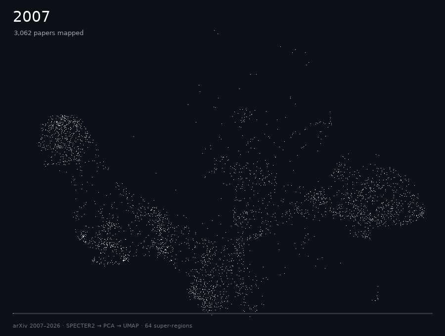
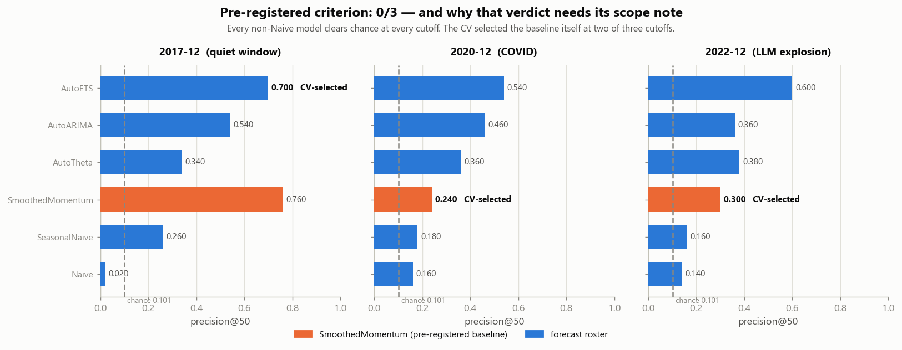
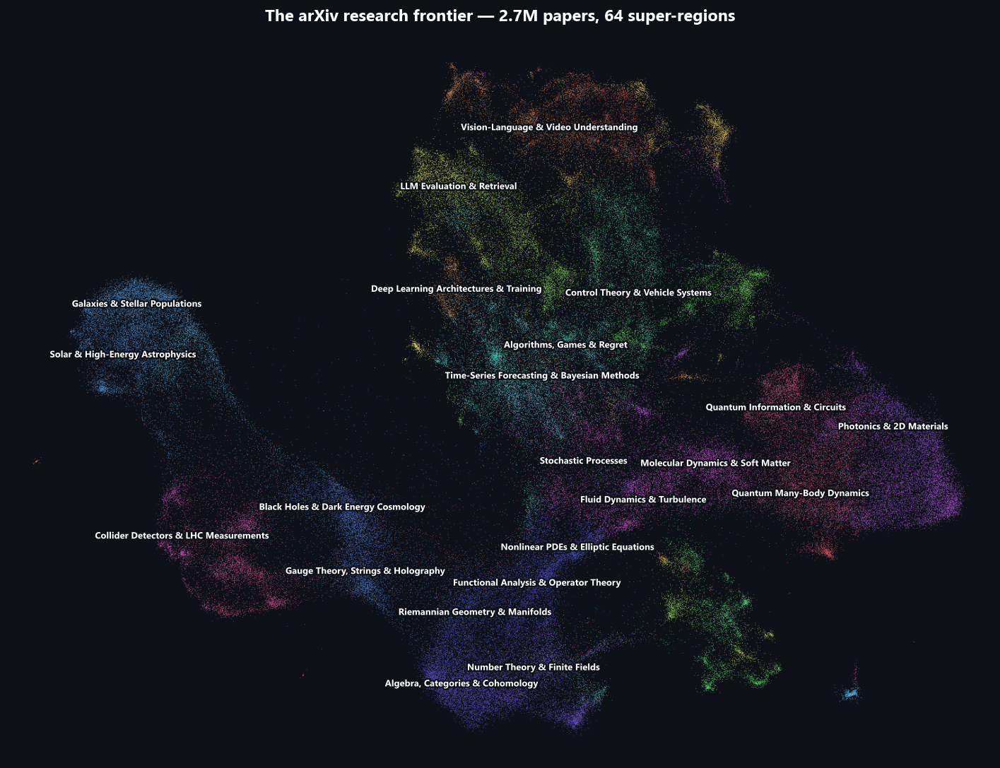
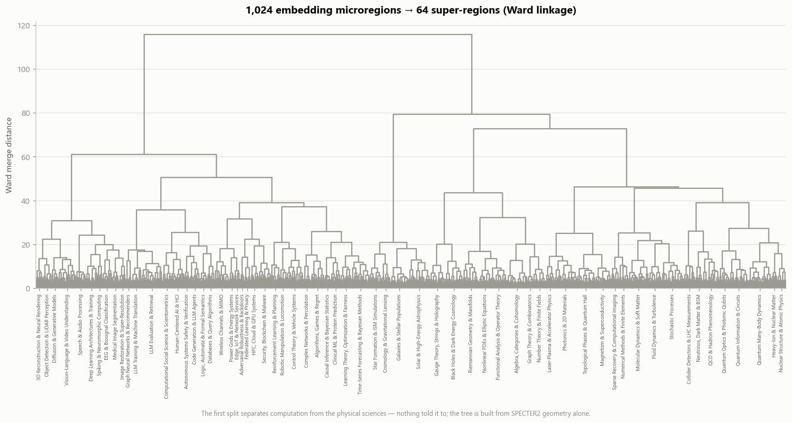
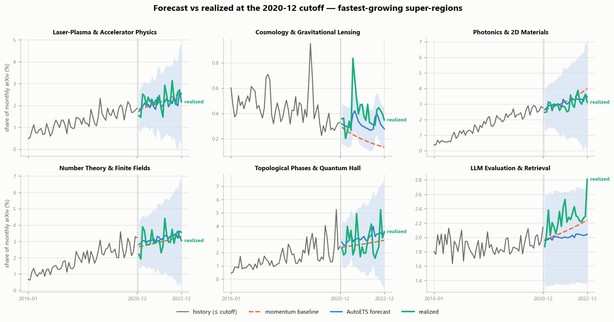
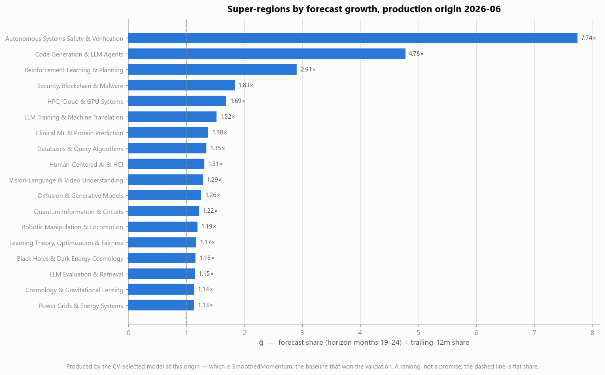
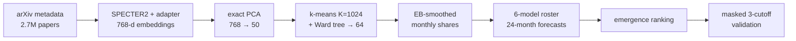

<!-- GENERATED by scripts/make_pypi_readme.py from README.md. DO NOT EDIT. -->


# brontide — forecasting the research frontier

> *brontide* (n.) — the low rumble of thunder from a storm still beyond the horizon.

[](https://github.com/numberingeometry/brontide/actions/workflows/verify.yml)
[](https://pypi.org/project/brontide/)
[](pyproject.toml)
[](LICENSE)

**Which corners of science are about to grow?** brontide places 2.7 million arXiv papers in a
semantic map, splits it into 1,024 research microregions, forecasts each region's share of
new papers 24 months ahead, and judges itself with a test that was frozen before any data
was touched. The test failed, and the repository says so on its first page, with the reason.

**[Open the live map](https://numberingeometry.github.io/brontide/)** · [Verify the headline in two seconds](#verify-it-yourself-in-two-seconds) · [What the result does and does not license](https://github.com/numberingeometry/brontide/blob/v0.1.1/LIMITATIONS.md)



| | |
|---|---|
| **Corpus** | 2,705,992 arXiv papers (titles and abstracts), 2007-01 → 2026-06, 234 months |
| **Representation** | SPECTER2 with its proximity adapter (14 GPU-hours), exact streamed PCA 768 → 50 |
| **Regions** | 1,024 k-means microregions → 64 Ward super-regions, LLM-named for display only |
| **Forecasts** | six-model roster (AutoETS, AutoARIMA, AutoTheta, three baselines), 24-month horizon |
| **Evaluation** | three masked cutoffs (2017-12, 2020-12, 2022-12); thresholds frozen 2026-07-22, scored 2026-07-23 |
| **Headline** | pre-registered criterion **not met (0/3)**; every non-naive model still beats chance |

## What it found

**1. The pre-registered test failed.** The go/no-go was committed at repo scaffold, before
any data existed, and scored the next day. It is reported verbatim:

> **Roster beat SmoothedMomentum on precision@50 in 0/3 cutoffs (need ≥2).
> Verdict: region-level emergence is momentum-dominated at 24m.**

**2. The models have signal; the step that picks between them lost it.** A fixed AutoETS
reaches **0.613** mean precision@50 against a **0.101** chance rate (6×), while the
cross-validated selector scored **0.413**. Two of the three "losses" were the selector
picking the baseline itself, so the test compared `0.240 > 0.240`. The 0.200 gap splits
exactly into two parts: choosing the best model per cutoff *with hindsight* would have added
only **0.020** over always using AutoETS, and the selector gave up **0.220**. The harness
selected on point accuracy and was scored on the top of a ranking; those are different
losses.



**3. Two follow-ups, each pre-registered before it was scored.**

- *Does the novelty stream add skill beyond the forecast?* **Yes, by the frozen criterion:**
  positive partial rank correlation with realised growth at 2 of 3 cutoffs
  ($\rho = 0.44$ and $0.38$, $p < 0.01$; $-0.08$ at 2020-12).
- *Are the published 80% intervals calibrated?* **No:** coverage lands in
  $[0.75, 0.85]$ in 3 of 9 model-cutoff cells (median 0.86). The diagnosis: they are
  calibrated against the raw share (9 of 9 cells) and over-cover the smoothed series they
  were fitted on, with heavier-than-normal tails.

The scope note on finding 1, the three harness defects, the four readings of the frozen
sentence (one of which flips it, and why that reading is indefensible), and the paired
tests are in **[LIMITATIONS.md](https://github.com/numberingeometry/brontide/blob/v0.1.1/LIMITATIONS.md)**. The frozen sentence is never edited:
`validate.py` hashes the pre-registration, and the hash `dea6cc0db2ae1e83` still verifies.

## Verify it yourself in two seconds

Every published number regenerates from committed artifacts: no raw corpus, no GPU, no
network.

```sh
git clone https://github.com/numberingeometry/brontide && cd brontide
pip install -e .
python scripts/verify_results.py
```

```
re-scored 3 cutoffs from committed artifacts (2017-12, 2020-12, 2022-12)
...
negative criterion: 0/3 (need >=2) -> region-level emergence is momentum-dominated at 24m
OK: all 18 published rows reproduce exactly.
```

The pre-registration ordering is checkable in git: thresholds at `c351507` (2026-07-22),
results appended at `95968ce` (2026-07-23), and every intervening edit an addition:

```sh
git log --follow --format='%h %ad %s' --date=short -- artifacts/validation.md
git diff --numstat c351507 9bfee13 -- artifacts/validation.md   # 18 insertions, 0 deletions
```

Continuous integration re-runs the headline, the selection decomposition, the two
follow-up criteria and a public-safety scan on every push.

## How the rigour is enforced

| Mechanism | What it prevents |
|---|---|
| Thresholds committed before data, content-hashed | moving the goalposts after seeing results |
| Masked refits at each cutoff (PCA, k-means, smoothing, novelty threshold fit on pre-cutoff data only) | look-ahead leakage through the geometry |
| Deterministic exact PCA (streamed covariance + `eigh`) | irreproducible masked runs |
| Every follow-up pre-registered in [`decisions/`](https://github.com/numberingeometry/brontide/blob/v0.1.1/decisions/README.md) before scoring | post-hoc analyses dressed as planned ones |
| `scripts/verify_*.py` recompute published numbers from committed artifacts | numbers that only exist in prose |
| `scripts/check_public_safe.py` | personal data or private material leaking into a public repo |

## The interactive map

**[numberingeometry.github.io/brontide](https://numberingeometry.github.io/brontide/)** opens
[`dashboard.html`](https://github.com/numberingeometry/brontide/blob/v0.1.1/dashboard.html): one self-contained file (no server, no CDN). Scrub the year
to watch the frontier fill in, hover for the region under the cursor, click any region for its
share history and forecast, and sort all 64 super-regions by forecast growth.



Region names are LLM-generated from each super-region's c-TF-IDF terms and sample titles
([`name_regions.py`](https://github.com/numberingeometry/brontide/blob/v0.1.1/src/brontide/name_regions.py), output committed to
[`artifacts/region_names.json`](https://github.com/numberingeometry/brontide/blob/v0.1.1/artifacts/region_names.json)). They are **cosmetic**: names
never enter the forecast, the emergence statistic, or the scored validation.

The hierarchy is unsupervised all the way down; nothing told it that computation and the
physical sciences are different:



## Forecasts against ground truth

At the 2020-12 cutoff, with everything after it masked (the cutoff where cross-validation
picked the baseline itself):



And what the model says at the production origin (2026-06):



## Pipeline



| # | Stage | Module | Where | Output |
|---|---|---|---|---|
| 1 | Ingest | `ingest.py` | compute host (~1 h) | `data/papers.parquet` (id, month, categories, title, abstract) |
| 2 | Embed | `embed.py` | **compute host GPU (~14 h measured)** | float16 memmap `N×768`, SPECTER2 + proximity adapter, resumable |
| 3 | Reduce | `reduce.py` | compute host | exact PCA 768→50 (streamed centered covariance + `eigh`; deterministic, batch-order invariant); UMAP 50→2 for display only |
| 4 | Regions | `regions.py` | compute host (~30 m) | MiniBatchKMeans **K=1024** + Ward tree → 64 super-regions |
| 5 | Series | `series.py` | compute host | EB-smoothed region-**share** monthly series + novelty stream |
| 6 | Forecast | `forecast.py` | compute host/CPU-only environment | statsforecast roster, 24m horizon, rolling-origin CV |
| 7 | Emergence | `emergence.py` | CPU-only environment | rank by ĝ; emerging / declining / saturating |
| 8 | Validate | `validate.py` | CPU-only environment | 3 cutoffs, precision@50 + Spearman + CSI vs the baseline |
| 9 | Labels | `labels.py`, `name_regions.py` | CPU-only environment | c-TF-IDF terms, then LLM names per super-region |
| 10 | Export | `export_map.py`, `export_figs.py`, `export_dashboard.py` | CPU-only environment | map binaries, 7 figures, dashboard |

Every numeric knob is frozen in **[`src/brontide/config.py`](https://github.com/numberingeometry/brontide/blob/v0.1.1/src/brontide/config.py)** and
mirrored, dated, into **[`artifacts/validation.md`](https://github.com/numberingeometry/brontide/blob/v0.1.1/artifacts/validation.md)** *before* any
scoring run.

### Three tiers of reproduction

| Tier | Command | Cost | Needs |
|---|---|---|---|
| Verify the headline | `python scripts/verify_results.py` | ~2 s | committed artifacts only |
| Rebuild figures + dashboard | `python scripts/run_figs.py && python scripts/run_dashboard.py` | ~1 min | committed artifacts only |
| Smoke-test the pipeline | `python scripts/smoke_test.py --sample 50000` | minutes | a corpus snapshot |
| Full rebuild | `run_ingest → run_embed → … → run_export` | ~16 h, ~10 GB | GPU + corpus snapshot |

```sh
conda env create -f environment.yml && conda activate brontide
pip install -e .
```

Every stage takes `--sample N` so the whole chain can be smoke-tested before a full run.
`data/` is gitignored; see [`data/README.md`](https://github.com/numberingeometry/brontide/blob/v0.1.1/data/README.md) for what belongs there and how
to rebuild it. Keeping the corpus current without disturbing the published result is
described in [`UPDATE-PLAN.md`](https://github.com/numberingeometry/brontide/blob/v0.1.1/UPDATE-PLAN.md).

## Data and model provenance

- **Corpus**: arXiv metadata (titles + abstracts), 2007-01 → 2026-06. arXiv metadata is
  distributed under CC0; the underlying papers remain under their authors' licenses and
  arXiv's Terms of Use.
- **Embeddings**: [`allenai/specter2_base`](https://huggingface.co/allenai/specter2_base)
  with the `allenai/specter2` proximity adapter (Singh et al., SciRepEval). Apache-2.0.
- **What is committed here**: region-level *aggregates* (share series, forecasts, emergence
  ranks), a 149,994-point display sample of 2-D coordinates, and 256 sample titles for
  labelling. No abstracts and no per-paper records are redistributed.
- Region names are LLM-generated; the exact prompt is in `name_regions.build_prompt`.

## Prior art

Large-scale research maps already exist. **Klavans, Boyack & Murdick** (PLOS ONE 2020) and the
deployed **CSET/ETO Map of Science** own scale and deployment (38–43M documents, ~15× the corpus
here), and **PreScience v2** (arXiv:2602.20459v2, Ai2 + UChicago) defines the share-change target
publicly. This project claims **no new formulation** and no priority. What it adds is the
pre-committed multi-cutoff out-of-time harness and an honest null. Full comparison in
**[RELATED-WORK.md](https://github.com/numberingeometry/brontide/blob/v0.1.1/RELATED-WORK.md)**.

> **Renamed 2026-08-11.** This project was developed under the internal codename *lacuna*,
> which collides with arXiv:2606.26246 (Mila), an unrelated static research map. Commits
> before the rename refer to the old name.

## Status

- Pipeline complete on the full corpus; all three cutoffs scored 2026-07-23.
- Figures, dashboard and the reproduction script landed 2026-08-11; continuous integration
  and the hosted map 2026-10-20.
- Follow-ups pre-registered 2026-08-12/13 ([`decisions/`](https://github.com/numberingeometry/brontide/blob/v0.1.1/decisions/README.md)): the novelty
  and interval-coverage criteria are scored above and re-checked in CI. The scale-spectrum and
  human-hierarchy controls read the full corpus in `data/`, which is not redistributed.
- The corpus can now absorb new papers without touching any scored artifact
  ([`UPDATE-PLAN.md`](https://github.com/numberingeometry/brontide/blob/v0.1.1/UPDATE-PLAN.md)). Open item: the analysis scripts that read `data/`
  assume the frozen 2,705,992-row corpus and still need to select that slice after an append.
- **Not built:** the agentic grader and the persistent-homology layer that earlier drafts
  described. Neither exists in `src/`; both were dropped rather than quietly carried.

## Layout

```
src/brontide/  ingest embed reduce regions series forecast emergence validate
               labels name_regions export_map export_figs export_dashboard + config.py
scripts/       run_<stage>.py thin runners · verify_*.py · smoke_test.py · check_public_safe.py
artifacts/     committed outputs + validation.md (the pre-registration record)
figures/       generated; regenerate with scripts/run_figs.py
decisions/     dated ADRs, immutable (index in decisions/README.md)
blueprint/     claims.yaml → LEDGER.md, plus the check.py gate
data/          gitignored: big intermediates
index.html     the project page served at numberingeometry.github.io/brontide
```

## License

MIT; see [LICENSE](https://github.com/numberingeometry/brontide/blob/v0.1.1/LICENSE).
