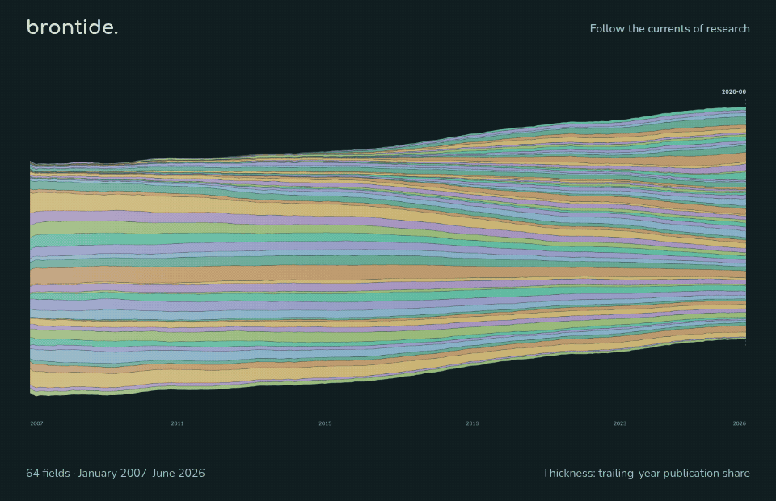

# brontide

A visual atlas of 2.7 million arXiv papers.

[](https://numberingeometry.github.io/brontide/)

Follow the currents of research, feel its pulse, then step into the landscape.

**[Open the atlas](https://numberingeometry.github.io/brontide/)** ·
[Field guide](docs/EXPLORER.md) · [Data & methods](docs/DATA.md)

## Run locally

```sh
python -m http.server 8000
```

Open `http://localhost:8000`. The included snapshot needs no corpus download or backend.

The map shows 149,994 sampled papers from January 2007–June 2026. Counts and histories
use the full aggregate data; density describes the display sample. Forecasts are archived
experimental outputs. [Data and limitations](docs/EXPLORER.md).

[Rebuild the data](data/README.md) · [MIT license](LICENSE)
