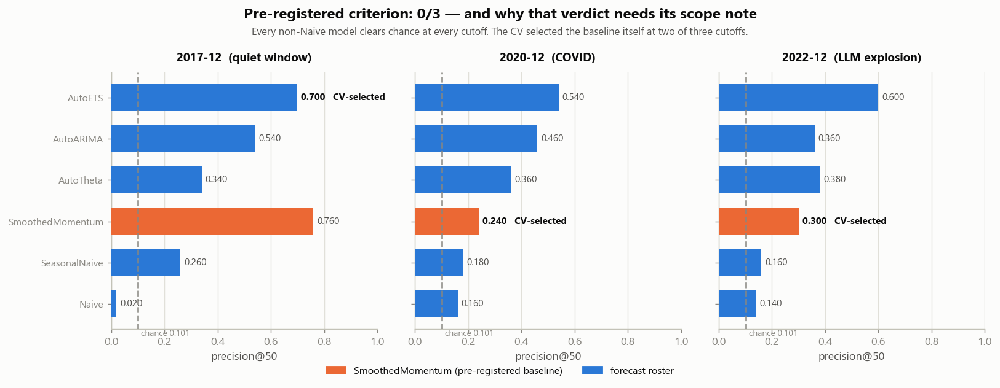

# Forecasting methods and archived results

Brontide's interactive atlas includes a fixed forecasting experiment on the 2007–June 2026
arXiv corpus. The tool and its visualization can evolve while these scored artifacts remain
unchanged.

## Representation and target

SPECTER2 proximity embeddings are reduced from 768 to 50 dimensions with a streamed
covariance eigendecomposition. K-means defines 1,024 microregions, and a Ward hierarchy
groups them into 64 broad regions. UMAP supplies display coordinates only.

The forecasting target is a region's share of monthly arXiv submissions, with empirical-Bayes
smoothing toward the parent region. Share separates relative activity from growth of the
corpus as a whole. For region $r$ and month $t$, the unsmoothed share is

$$
p_r(t)=\frac{N_r(t)}{\sum_s N_s(t)}.
$$

The statistical roster contains AutoETS, AutoARIMA, AutoTheta and three baselines. The
horizon is 24 months. Evaluation masks everything after each of three cutoffs:
December 2017, December 2020 and December 2022. Geometry fitting and model evaluation in
those scored runs use the cutoff-specific protocol, separate from the retrospective atlas.

## Recorded criterion

The preregistered criterion required the selected roster to beat SmoothedMomentum on
precision@50 at at least two cutoffs. It met the criterion at **zero of three**.
The recorded sentence is retained in [the validation record](../artifacts/validation.md).
Its interpretation requires the harness limitations in [LIMITATIONS.md](../LIMITATIONS.md).



## Model selection

A fixed AutoETS achieved mean precision@50 of **0.613**, against a chance rate of **0.101**.
The cross-validated selector achieved **0.413**. Selecting the best model per cutoff with
hindsight would have added 0.020 over the fixed AutoETS; the selector lost 0.220 relative
to that hindsight choice. Thus the net gap is $0.020-0.220=-0.200$.

The harness selected on point accuracy and reported a top-of-ranking objective. Two of
the three non-wins were ties because the selector chose the comparator itself. These
facts limit broad claims about whether a region is forecastable.

## Follow-up analyses

The novelty stream met its frozen incremental-skill criterion at two of three cutoffs:
positive partial rank correlations of 0.44 and 0.38, with a negative value at the remaining
cutoff. This is a scoped retrospective result rather than a guarantee for new topics.

The nominal 80% intervals met the stated coverage range in three of nine model–cutoff cells.
The median coverage was 0.86. They over-covered the smoothed target and are not presented
as calibrated uncertainty for the atlas's future trajectories.

The explorer's production curves use SmoothedMomentum from the June 2026 origin.
Region forecasts are independent and are not jointly normalized to sum to 100%.

## Reproduction and provenance

```sh
python -m pip install -e .
python scripts/verify_results.py
python scripts/verify_selectionconsistency.py
python scripts/verify_coverage.py
git log --follow --format='%h %ad %s' --date=short -- artifacts/validation.md
```

The verifiers recompute the published tables from committed artifacts. The dated history
records the threshold specification before scored results were added. Content hashes
check integrity; chronology is established by the history and experimental record.

The full interpretation, paired comparisons and follow-up boundaries remain in
[LIMITATIONS.md](../LIMITATIONS.md) and [the decision index](../decisions/README.md).
